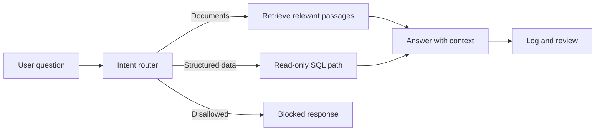

# Firm Assistant

**Question.** How can a small firm ask natural-language questions about its own documents and records while keeping database access controlled?

Firm Assistant is a personal n8n project described in my [portfolio](https://nour2303.github.io/). The live workflow routes questions to document retrieval, read-only SQL, or a blocked response. It also uses semantic caching and logging.

## Workflow exports

The three JSON files in [workflows/](workflows/) were exported from the n8n **firm assistant** folder on 15 October 2026:

- [Main assistant](workflows/firm-assistant.json) — routing, RAG, read-only SQL request path, cache, and logs.
- [Evaluation workflow](workflows/firm-assistant-evals.json) — retrieves evaluation cases and checks RAG, SQL, and blocked-request responses.
- [Document ingestion](workflows/document-ingestion.json) — watches a Google Drive folder, extracts PDF text, and stores embeddings.

These public copies have credential references, API header values, instance IDs, pinned data, the Supabase project URL, and the Drive folder ID removed. They are **review copies**, not ready-to-run imports. Configure your own services and permissions before testing them.

## Evaluation tests

The evaluation workflow includes separate RAG, SQL, and blocked-request checks plus an LLM judge for answers where wording can vary. Its `Get Eval Tests` node reads cases from Supabase; those rows and execution logs are not in the export. This repository therefore does not claim an independently verified reliability rate.

## Design boundaries and limits

- Intended SQL behavior: reject non-`SELECT` statements and use a read-only database connection.
- The live canvas and exports show Gemini, Supabase/PostgreSQL, OpenRouter, n8n, retrieval, and caching. The sanitized copies are not a deployment configuration.
- A sample schema, evaluation case rows/results, and demo recording have not been included.
- Before deployment, test access control, ambiguous questions, missing data, cache invalidation, malformed input, and sensitive-data exposure with real logs.

**Portfolio status:** personal project; no paying-client deployment or production security review is claimed.
