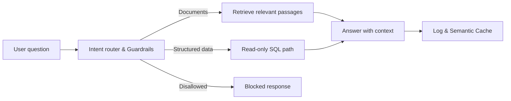

# Firm Assistant — RAG & Read-Only SQL Workflow System

**Overview:** How can a team ask natural-language questions across both company documents and structured database records while keeping database access strictly controlled?

**Firm Assistant** is a three-workflow AI system built in **n8n** and featured in my [portfolio](https://nour2303.github.io/). It routes incoming questions to document retrieval (RAG), a read-only SQL database agent, or a guardrail block response, complete with semantic caching, request logging, and automated evaluations.

## Architecture & Workflows

The repository includes three modular n8n workflows in [`workflows/`](workflows/):

1. **[Main Assistant (`firm-assistant.json`)](workflows/firm-assistant.json)** — Handles intent classification, guardrail routing, vector retrieval (RAG), read-only SQL query generation, semantic caching, and structured request logging.
2. **[Automated Evaluation Pipeline (`firm-assistant-evals.json`)](workflows/firm-assistant-evals.json)** — Runs test cases across RAG, SQL, and guardrail paths and scores responses using deterministic checks and an LLM-as-a-Judge evaluator.
3. **[Document Ingestion (`document-ingestion.json`)](workflows/document-ingestion.json)** — Watches a Google Drive folder, extracts PDF text, chunks documents, and writes vector embeddings to Supabase/PostgreSQL.

## Key Capabilities

- **Guardrails & Read-Only Enforcement:** Rejects non-`SELECT` or destructive database queries and blocks out-of-policy requests before execution.
- **Hybrid Knowledge Access:** Combines unstructured document search (Google Drive PDFs + vector store) with structured SQL querying in a single assistant interface.
- **LLMOps & Observability:** Logs request metadata, routing decisions, and responses to Supabase, paired with an automated evaluation workflow to verify routing and answer quality.

## Setup & Configuration

All credential IDs, API keys, instance identifiers, and private project URLs have been sanitized for security. To deploy these workflows in your own n8n environment:

1. Import the three JSON files from [`workflows/`](workflows/) into n8n.
2. Connect your **Supabase / PostgreSQL**, **Google Drive**, and **OpenRouter / Gemini** credentials.
3. Configure a read-only database role for the SQL query node and point the ingestion workflow to your target Google Drive folder.
