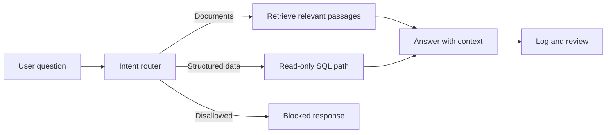

# Firm Assistant

**Question.** How can a small firm ask natural-language questions about its own documents and records while keeping database access controlled?

Firm Assistant is a personal n8n practice project described in my [portfolio](https://nour2303.github.io/). The supplied project summary describes a route for document retrieval, a route for read-only SQL questions, and a blocked route for requests outside those boundaries. It also describes semantic caching and logging.

## Evaluation tests

The project summary describes evaluation tests for the assistant's responses and request handling. The test cases and execution logs are not included here, so this repository does not claim an independently verified reliability rate.

## Design boundaries and limits

- Intended SQL behavior: reject non-`SELECT` statements and use a read-only database connection.
- The summary names Gemini, Supabase/PostgreSQL, n8n, retrieval, and caching. Exact versions and deployment configuration are not documented here.
- A workflow export, sample schema, evaluation cases/results, and demo recording have not been included. This README is an architecture and evidence summary, not an importable workflow.
- Before deployment, test access control, ambiguous questions, missing data, cache invalidation, malformed input, and sensitive-data exposure with real logs.

**Portfolio status:** personal project; no paying-client deployment or production security review is claimed.
